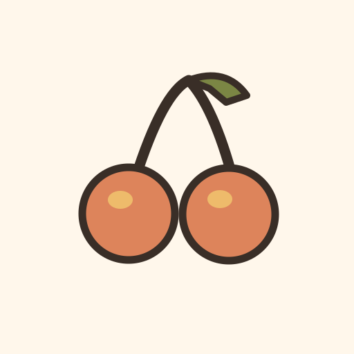

<div align="center">



🍒

# Git Cherry Pick Interactive


**A CLI tool that provides an interactive way to cherry-pick commits from a specified branch.**

<a href="https://kud.io/projects/git-cherry-pick-interactive-cli">Website</a> · <a href="https://kud.io/projects/git-cherry-pick-interactive-cli/docs">Documentation</a>

</div>

## Features

- **Interactive UI** — easily view and select commits with an intuitive interface
- **Only what's missing** — lists the commits on the branch that aren't already on yours, oldest first, so they replay the right way round
- **Clear output** — each cherry-picked commit is displayed with its hash and message, providing clarity and transparency
- **Error handling** — clear error messages and instructions for better usability

## Install

```sh
npm install -g @kud/git-cherry-pick-interactive-cli
```

Binary: `git-cherry-pick-interactive`, so git also runs it as `git cherry-pick-interactive` · Requires Node.js >= 20

## Usage

```console
$ git cherry-pick-interactive <branch-name>
```

Replace `<branch-name>` with the name of the branch you want to cherry-pick commits from.

After executing the command, you will be presented with a list of commits from the specified branch. Select the commits you'd like to cherry-pick using the arrow keys and spacebar. Once your selections are made, press the Enter key to proceed with the cherry-picking process.

[](https://asciinema.org/a/lSFWbYVyDRzQLFillzlAX6uX1)

## Dependencies

- `@inquirer/prompts`: the commit picker.
- `chalk`: Provides terminal string styling.
- `simple-git`: A lightweight interface for running git commands in any Node.js application.

## Development

```sh
git clone https://github.com/kud/git-cherry-pick-interactive-cli.git
cd git-cherry-pick-interactive-cli
npm install
npm run dev
```

| Script              | Purpose                              |
| ------------------- | ------------------------------------ |
| `npm run build`     | Bundle to `dist/` with tsup          |
| `npm run dev`       | Run directly via tsx (no build step) |
| `npm run typecheck` | Type-check with `tsc --noEmit`       |
| `npm test`          | Run the vitest suite                 |

## Licence

MIT

📚 **Full documentation → [git-cherry-pick-interactive-cli/docs](https://kud.io/projects/git-cherry-pick-interactive-cli/docs)**
